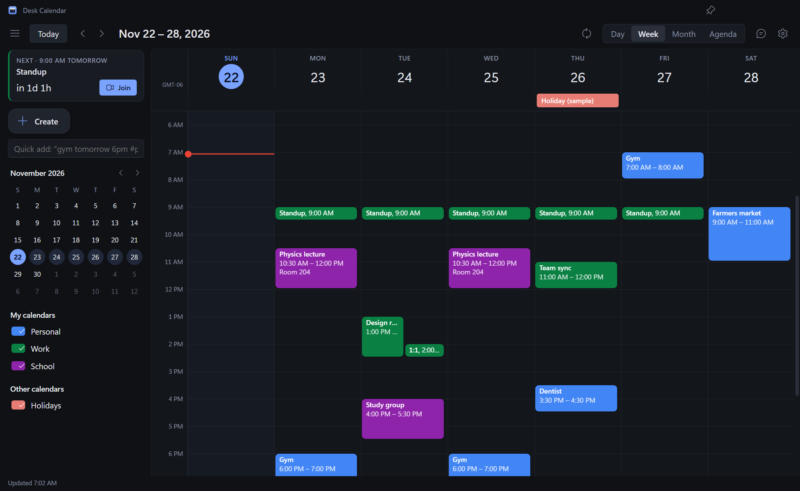
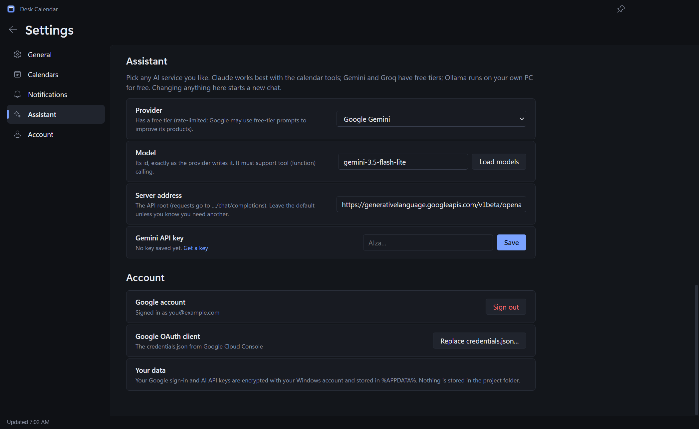

# Desk Calendar

A dark, Windows 11-style desktop app for **Google Calendar**, with an **AI assistant** that can read and
change your schedule. Built with Electron. Bring your own Google Cloud project and your own AI provider
(Claude, Gemini, OpenAI, Groq, OpenRouter, a local model through Ollama, or any OpenAI-compatible server).



## Features

- **Day / Week / Month / Agenda** views that work like Google Calendar, across **all your calendars** in their Google colors
- **Click an empty slot to create**, **drag to move**, **drag the bottom edge to resize**, click an event for details
- **Quick add** in plain English: `gym tomorrow 6pm`, `lunch w/ Sam fri 12:30-2pm #personal`, `standup 9am for 15 min`
- **Countdown** to your next event, with a **Join** button for Meet / Zoom / Teams links
- Full editor with **color**, **notifications** (reminders) and **Google Meet**
- **Assistant** side panel: "move gym to 7pm", "what's on Friday?", "delete my 3pm" (with Undo)
- **Desktop notifications** before events, **tray icon**, **Ctrl+Shift+Space** to show/hide, **starts with Windows**
- **Mica** background, Fluent icons, keyboard shortcuts (D / W / M / A views, T today, J / K previous/next, C create)
- **Your secrets stay on your PC**: Google sign-in and API keys are encrypted with your Windows account (DPAPI)

## What you need

| | |
|---|---|
| Windows 10 or 11 | The app uses Windows features (Mica, tray, DPAPI). It may run elsewhere, but only Windows is tested. |
| [Node.js](https://nodejs.org/) 20 or newer | Includes npm. Check with `node -v`. |
| [Git](https://git-scm.com/download/win) | To clone this repository. |
| A Google account | The calendar you want to see. |
| A Google Cloud project (free) | You create your own OAuth client in about 10 minutes: [SETUP-GOOGLE.md](SETUP-GOOGLE.md). |
| An AI provider (optional) | Only for the assistant. Several are free: [docs/ASSISTANT.md](docs/ASSISTANT.md). |

Nobody shares credentials here: everyone who runs this app sets up their **own** Google Cloud project and
their **own** AI key. Nothing secret is in this repository.

## Quick start

```powershell
git clone <this repository's URL>
cd desk-calendar
npm install
npm start
```

Then:

1. Follow **[SETUP-GOOGLE.md](SETUP-GOOGLE.md)** once to get your `credentials.json`.
2. In the app, click **Load credentials.json…**, then **Sign in with Google**.
3. Optional: open **Settings → Assistant**, pick a provider and paste its API key
   (see **[docs/ASSISTANT.md](docs/ASSISTANT.md)**).

Something not working? See **[docs/TROUBLESHOOTING.md](docs/TROUBLESHOOTING.md)**.

## Build the installer

```powershell
npm run dist
```

This produces `dist\Desk Calendar Setup 1.0.0.exe`. Run it to install (Start menu + desktop shortcut,
uninstall via Windows Settings → Apps). The installer is **unsigned**, so Windows SmartScreen says
"Windows protected your PC". Click **More info → Run anyway**. That's normal for personal apps.

Only `src/` and `package.json` (plus dependencies) go into the package, so a `credentials.json` sitting in
the project folder is **not** shipped. Each installed copy loads its own credentials on first run.
Start with Windows only takes effect in the installed app.

## The assistant



Pick a provider in **Settings → Assistant**. The assistant gets five tools (list calendars, list events,
create, update, delete) and calls them itself; you see a card for every change, and deletes can be undone.

| Provider | Cost | Notes |
|---|---|---|
| Claude (Anthropic) | Pay per use, about $0.002 a message on Haiku | Most reliable with the calendar tools. The default. |
| Google Gemini | Free tier | Free-tier prompts may be used by Google to improve its products. |
| Groq / Cerebras | Free tier or trial | Fast hosted open models (gpt-oss, Llama, Qwen). |
| OpenRouter | `:free` models, about 50 requests a day | One key, hundreds of models. |
| OpenAI | Pay per use | |
| Ollama / LM Studio | Free | Runs on your PC; nothing leaves your computer. Needs a capable machine. |
| Anything OpenAI-compatible | Varies | Cloudflare Workers AI, Together, vLLM, a company gateway… |

Step-by-step setup for each one, model suggestions and privacy notes: **[docs/ASSISTANT.md](docs/ASSISTANT.md)**.

## How it's organized

```
src/
├─ main/                  ← BACKEND (Node.js). Talks to Google and the AI provider. Holds all secrets.
│  ├─ main.js             startup + the list of IPC handlers the UI may call (incl. delete-with-undo)
│  ├─ windowManager.js    the window: size/position memory, Mica, Windows' own caption buttons, × = hide
│  ├─ background.js       tray icon + menu, global hotkey, start with Windows
│  ├─ notifier.js         desktop notifications before events
│  ├─ prefs.js            non-secret settings (prefs.json) and their defaults
│  ├─ auth.js             Google OAuth (loopback + PKCE), token refresh
│  ├─ secureStore.js      encrypts tokens/keys with Windows DPAPI (Electron safeStorage)
│  ├─ calendar.js         Calendar API: calendars, events, create/update/delete, colors, reminders, Meet
│  ├─ quickadd.js         "gym tomorrow 6pm #work" → {title, start, end, calendar} using chrono-node
│  ├─ providers.js        the AI providers the assistant can use (add your own here)
│  └─ assistant.js        assistant: tool definitions + the tool-use loop (Claude and OpenAI-compatible)
├─ preload.js             the bridge: exposes window.desk.* to the page, nothing else
├─ assets/                app icon (icon.svg is the source) + Fluent UI icons (MIT)
└─ renderer/              ← FRONTEND (sandboxed web page). No Node, no secrets.
   ├─ index.html          layout (title bar, toolbar, sidebar, views, panels, dialogs)
   ├─ styles.css          dark theme (colors and sizes are variables at the top)
   ├─ icons.css           generated by scripts/copy-icons.js
   └─ js/
      ├─ util.js          helpers, date formatting, popovers
      ├─ data.js          shared state, date navigation, loading events
      ├─ sidebar.js       countdown, Create, quick add, mini month, calendar lists
      ├─ view-time.js     Day & Week hour grid (overlap layout, all-day row, now line)
      ├─ view-month.js    Month grid (spanning bars, "+N more")
      ├─ views.js         toolbar, picking the view, Agenda view
      ├─ interactions.js  click/drag to create, move, resize; details popover; undo toast
      ├─ editor.js        full event editor (color, notifications, Meet)
      ├─ chat.js          assistant side panel
      ├─ settings.js      settings page
      └─ app.js           startup, sign-in screen, keyboard shortcuts, timers
docs/
├─ ASSISTANT.md           choosing and setting up an AI provider
├─ TROUBLESHOOTING.md     common problems and fixes
├─ UI-SPEC.md, ui/        design history: the original UI spec and questionnaire (older screenshots)
└─ screenshots/           README images (made-up sample data)
scripts/                  icon generation (npm run icons, npm run icons:copy)
build/icon.ico            installer icon
```

How a drag flows: `interactions.js` calls `desk.updateEvent(...)` → `preload.js` sends IPC message
`cal:update` → `main.js` handler → `calendar.updateEvent()` → Google API → result travels back the same way.

## Where your secrets live

| What | Where | Protection |
|---|---|---|
| `credentials.json` (your OAuth client) | `%APPDATA%\desk-calendar\` (dev) or `%APPDATA%\Desk Calendar\` (installed) | Outside the repo; `.gitignore` blocks it if you put one in the project |
| Google access/refresh token | same folder, `google-token.bin` | Encrypted with DPAPI, tied to your Windows account |
| AI API keys | same folder, `anthropic-key.bin`, `assistant-key-<provider>.bin` | Encrypted with DPAPI |
| Preferences, window position | same folder, `prefs.json`, `window.json` | Not secret (plain JSON, no keys) |

Nothing secret is ever written in plain text, and none of it is inside the project folder.
Settings → Account → **Sign out** deletes the Google token and revokes it with Google.

`.gitignore` also blocks `credentials.json`, `client_secret*.json`, `token*.json`, `*.bin`, and `.env*`,
so a stray secret in the project folder can't be committed by accident.

## Common changes

Most everyday options are in the app's **Settings** page. For deeper changes:

| I want to… | Edit |
|---|---|
| Refresh more/less often | `REFRESH_MINUTES` at the top of `src/renderer/js/data.js` |
| Change colors / font / sizes | variables in `:root` in `src/renderer/styles.css` |
| Taller/shorter hours in Day/Week | `HOUR_H` in `view-time.js` (and the matching `48px` in `.tg-col` in styles.css) |
| Drag snapping | `SNAP_MIN` in `src/renderer/js/interactions.js` |
| Undo window after delete | `UNDO_MS` in `src/main/main.js` |
| Default window size | `DEFAULT_SIZE` in `src/main/windowManager.js` |
| Suggestion chips in the assistant | `SUGGESTIONS` in `src/renderer/js/chat.js` |
| Add an AI provider or change a default model | `PROVIDERS` in `src/main/providers.js` |
| Claude models, prices, effort | `MODELS` in `src/main/assistant.js` |
| Assistant behavior/tone | `SYSTEM` prompt in `src/main/assistant.js` |
| Give the assistant a new ability | add an entry to `TOOLS` and a `case` in `runTool()` in `assistant.js` (works for every provider) |
| Add an icon | add its name to `ICONS` in `scripts/copy-icons.js`, then `npm run icons:copy` |
| Change the app icon | edit `src/assets/icon.svg`, then `npm run icons` |

## Notes and limits

- **Testing-mode sign-in lasts 7 days.** See the end of SETUP-GOOGLE.md for how to avoid it.
- Editing or dragging a recurring event changes **only that occurrence**.
- Events you've declined are hidden, like in Google Calendar.
- Deleting shows **"Event deleted · Undo"** for 6 seconds before it's really deleted. Quitting from the
  tray finishes pending deletes; killing the process (Ctrl+C in a terminal) within those 6 seconds cancels them.
- The assistant's quality depends on the model. Small local models sometimes pick the wrong event or
  skip a tool call; larger hosted models are more dependable. Deletes are always undoable.
- Windows shows notifications for the installed app; while running from `npm start` they may not appear.
