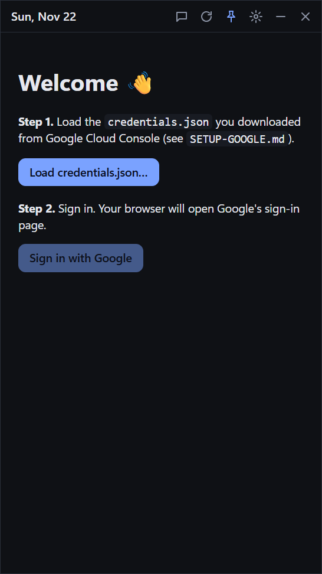
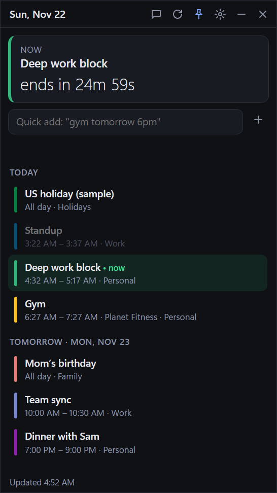
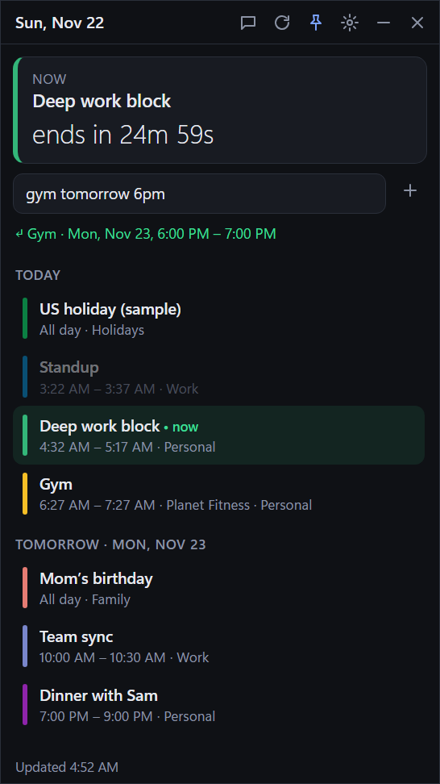
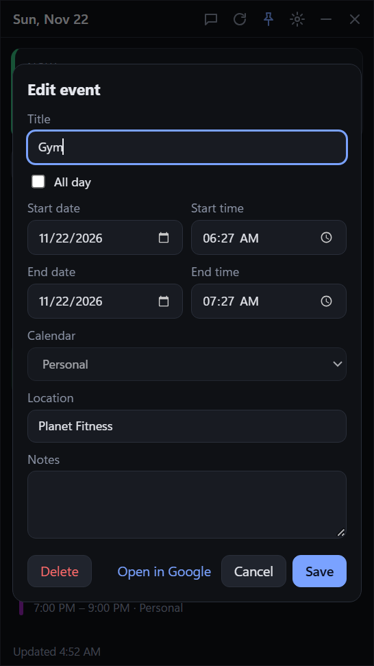
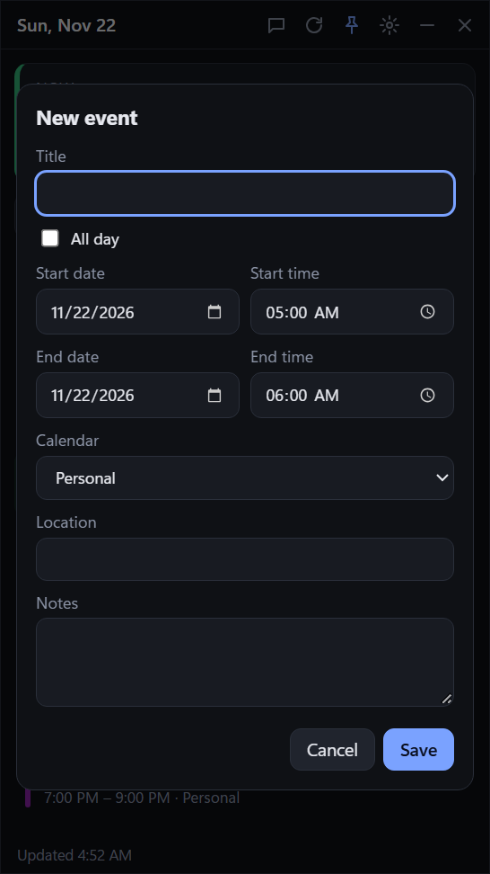
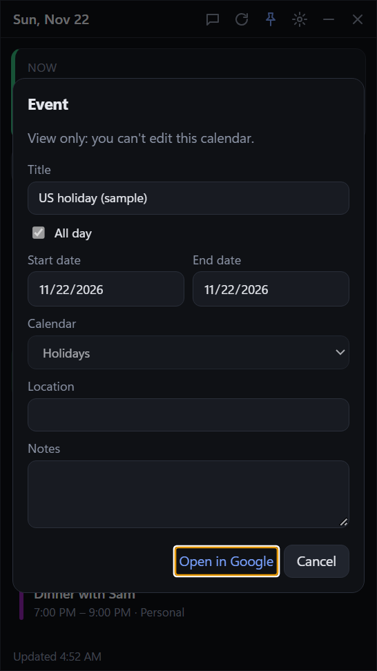
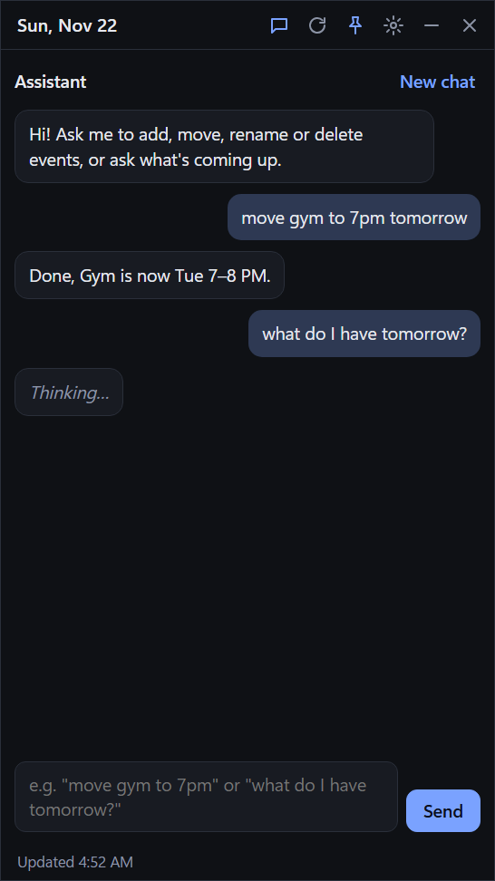
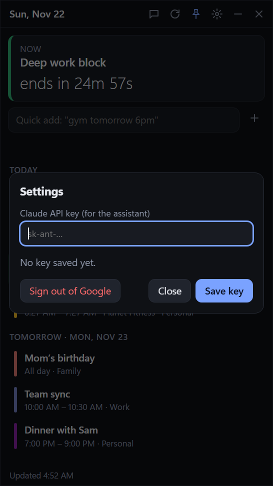

# Desk Calendar: current UI spec + redesign questionnaire

**How to use this file**

1. Part 1 describes exactly what's in the app today, with screenshots (sample data, not your calendar).
2. Part 2 is the questionnaire. Write your answers right under each question, after the `→`.
   Tick options with `[x]`. Write `keep` to keep something as it is.
   **A blank answer means "keep it as it is."**
3. Add anything the questions don't cover in **Part 3** (free-form notes, links, mockups).
4. Send the file back and I'll apply the changes. If something is ambiguous, I'll ask before building.

Screens like this are much easier to get right with references. If you have screenshots of widgets or
apps whose look you like, drop them in `docs/ui/refs/` and mention the file names.

---

# Part 1: What's there today

## 1.1 Screens at a glance

| | |
|---|---|
|  **Setup** (first run / signed out) |  **Main view** |
|  **Quick-add preview** |  **Edit event** |
|  **New event** (+ button) |  **Read-only event** |
|  **Assistant** |  **Settings** |

## 1.2 Window

| Property | Current value |
|---|---|
| Default size | 360 × 640 px |
| Minimum size | 300 × 380 px |
| Resizable | Yes, by dragging the edges |
| Frame | None (Windows title bar removed); custom 36 px title bar; 1 px border around the window |
| Always on top | On by default; toggled by the pin button; remembered |
| Position & size | Remembered between launches |
| Taskbar | Shows in the taskbar like a normal app; no tray icon |
| Start with Windows | No |
| Transparency / blur | None (solid background) |
| Multiple copies | Prevented; launching again focuses the existing window |

## 1.3 Design tokens (colors, type, shape)

All of these live in `:root` at the top of `src/renderer/styles.css`.

**Colors** (dark only; there is no light theme)

| Token | Hex | Used for |
|---|---|---|
| `--bg` | `#0f1115` | Window background, dialog background |
| `--surface` | `#181b22` | Cards, inputs, bot chat bubbles |
| `--surface-2` | `#20242d` | Hover backgrounds, secondary buttons |
| `--border` | `#2a2f3a` | Borders, dividers, scrollbar thumb |
| `--text` | `#e6e8ee` | Main text |
| `--muted` | `#8b93a5` | Secondary text, labels, icons at rest |
| `--accent` | `#7aa2ff` | Primary buttons, focus rings, active icons, links, default countdown stripe |
| `--danger` | `#ff6b6b` | Delete / sign out text, errors |
| `--now` | `#3ddc97` | "now" highlight, quick-add preview text |
| (close hover) | `#c42b1c` | Close button hover (Windows red) |
| Event colors | from Google | Calendar color, or the event's own color if set in Google Calendar |

Google event color mapping (used when an event has its own color): Lavender `#7986cb`,
Sage `#33b679`, Grape `#8e24aa`, Flamingo `#e67c73`, Banana `#f6bf26`, Tangerine `#f4511e`,
Peacock `#039be5`, Graphite `#616161`, Blueberry `#3f51b5`, Basil `#0b8043`, Tomato `#d50000`.

**Typography**: font stack `Segoe UI Variable Text`, `Segoe UI`, system-ui. Base 13 px, line-height 1.4.

| Element | Size / weight / style |
|---|---|
| Title bar date | 13 px, 600 |
| Countdown label ("NOW" / "NEXT · 6:00 PM") | 11 px, uppercase, 0.6 px letter-spacing, muted |
| Countdown event title | 15 px, 600, one line, ellipsis |
| Countdown time ("ends in 24m 59s") | 22 px, 300, tabular numbers |
| Day header ("TODAY", "TOMORROW · MON, NOV 23") | 11 px, 600, uppercase, 0.6 px spacing, muted |
| Event title | 13 px, 500, one line, ellipsis |
| Event meta line | 11.5 px, muted, one line, ellipsis |
| Quick-add preview | 12 px |
| Status footer | 11 px, muted |
| Dialog heading | 15 px |
| Form labels | 12 px, muted |

**Shape and spacing**

| Thing | Value |
|---|---|
| Card radius (`--radius`) | 10 px |
| Inputs, buttons, event rows | 8 px radius |
| Icon buttons | 28 × 28 px, 6 px radius, 16 px icon |
| Dialogs | 12 px radius, max 420 px wide, 14 px padding, 55% black backdrop |
| Main area | 10 px padding, 8 px gap between sections |
| Event row | 7 × 8 px padding, 10 px gap; color bar 4 px wide |
| Icons | Inline line icons (SVG), 2 px stroke, round caps |
| Animations | None |

## 1.4 Title bar (top, 36 px, drag to move the window)

Left: today's date (`Sun, Nov 22`). Right, in order:

| Button | Icon | Does |
|---|---|---|
| Assistant | speech bubble | Swaps the event list for the chat panel (icon turns blue while open) |
| Refresh | circular arrow | Re-fetches events now |
| Pin | push-pin | Toggles always-on-top (blue = on) |
| Settings | gear (⚠ reads more like a sun) | Opens Settings |
| Minimize | — | Minimizes |
| Close | × | Quits the app (red on hover) |

## 1.5 Main view (top to bottom)

**Countdown card**
- Left stripe (4 px) takes the color of the event it's about.
- If an event is happening now *and* nothing starts in the next 5 min: label `NOW`, title, `ends in 24m 59s`.
- Otherwise the next timed event: label `NEXT · 6:00 PM` (plus ` tomorrow` if it's tomorrow), title, `in 1h 35m`.
- Time format: `1h 05m` above an hour, `12m 04s` under an hour, `45s` under a minute. Ticks every second.
- Nothing left: `Nothing else through tomorrow 🎉`.
- All-day events are ignored by the countdown.

**Quick-add box**
- Placeholder: `Quick add: "gym tomorrow 6pm"`. A **+** button on the right opens the full New-event form.
- As you type (after a 120 ms pause), a preview line appears under it in green:
  `↵ Gym · Mon, Nov 23, 6:00 PM – 7:00 PM`. If no date/time is found, a gray hint shows instead.
- Enter creates the event in your primary calendar. No time given → all-day. Default length 1 hour.
- ⚠ The preview line reserves its space even when empty, which leaves a visible gap under the box.

**Event list** (scrolls)
- Two sections: `TODAY` and `TOMORROW · MON, NOV 23`.
- Order: all-day events first, then by start time. Multi-day events appear on each day they cover.
- Row: color bar · title on line 1 · meta on line 2: `6:27 AM – 7:27 AM · Planet Fitness · Personal`
  (time range or `All day` · location if any · calendar name).
- States:
  - **Past**: whole row at 45% opacity.
  - **Now**: green-tinted background plus green `• now` after the title.
  - **Hover**: lighter background.
- Empty day: `Nothing scheduled`.
- Click a row to open the editor. Declined meetings are hidden.
- Not shown: Meet/Zoom links, attendees, RSVP status, descriptions (only in the editor).

**Status footer** (bottom): `Updated 4:52 AM`, `Refreshing…`, short confirmations (`Added "Gym"`, `Saved`,
`Deleted`), or errors in red.

## 1.6 Event editor (dialog)

- Titles: `New event`, `Edit event`, or `Event` (read-only).
- Fields: Title · All day checkbox · Start date + Start time · End date + End time (times hidden for
  all-day) · Calendar dropdown (editable only for new events) · Location · Notes.
- Buttons: `Delete` (red, left) · `Open in Google` (link) · `Cancel` · `Save` (blue).
- New-event defaults: next whole hour, 1 hour long, primary calendar.
- Read-only events (holidays, others' calendars): fields disabled, note `View only: you can't edit
  this calendar.`, only `Open in Google` and `Cancel`.
- Delete asks with the browser's plain confirm box (`Delete "Gym"?`).
- No reminders, recurrence, color, guests or video-link fields.

## 1.7 Assistant (chat panel)

- Replaces the countdown, quick-add and event list while open. The title bar stays.
- Header `Assistant` with a `New chat` link.
- Bubbles: you on the right (blue-tinted), assistant on the left (dark with border). `Thinking…` in
  gray italic while waiting; errors in red.
- Input: 2-line text box + blue `Send`. Enter sends, Shift+Enter adds a new line.
- First message: a greeting, or a prompt to add the API key in Settings.
- Conversation is forgotten when the app closes. Plain text only (no formatting).
- Deleting through the assistant always shows a Windows confirmation dialog.

## 1.8 Settings (dialog)

- Claude API key (password field) + status line (`No key saved yet.` / `✔ A key is saved…`).
- Buttons: `Sign out of Google` (red) · `Close` · `Save key` (blue).
- Nothing else is configurable from the UI. Refresh interval, days shown, default duration and
  colors are set in code.

## 1.9 Setup screen

`Welcome 👋` heading, Step 1 `Load credentials.json…` (dims once loaded), Step 2 `Sign in with Google`
(disabled until step 1 is done), and a message line for progress/errors.

## 1.10 Behavior and timing

| What | Current |
|---|---|
| Auto refresh | Every 3 minutes |
| Refresh on focus | When you click back into the window and data is over 1 minute old |
| Countdown | Updates every second |
| Midnight | Date and lists roll over automatically |
| Keyboard shortcuts | Only Enter (quick add / chat) and Shift+Enter (chat). No global hotkey |
| Notifications / reminders | None |
| Time format | Follows Windows' regional setting (12-hour on yours) |

## 1.11 Feasibility notes (so you know what's cheap vs. expensive)

- **Easy:** any color, size, spacing, font (bundled with the app, since remote fonts are blocked for
  security), icons, reordering sections, more days, 24-hour time, settings toggles, hiding things.
- **Medium:** light/system theme, Windows 11 Mica/acrylic blur, collapsible sections, a tray icon,
  start-with-Windows, global show/hide hotkey, desktop notifications before events, assistant
  shortcuts/chips, saving chat history.
- **Bigger:** week/month grid views, drag-to-reschedule, recurring-event editing ("all events"),
  guests/Meet links in the editor, multiple windows.

---

# Part 2: Questions

> **Summary of the direction:** Desk Calendar is no longer a small always-on-top widget. It becomes a
> **full-size, resizable Windows 11 calendar app** that looks and works much like Google Calendar.
> It gets **Day / Week / Month / Agenda views**, a sidebar holding the countdown and quick add, a
> **maximize/restore button**, **Mica** background, **dark only**, **roomier** spacing, plus a tray icon,
> start with Windows, a global hotkey and notifications.
> See Part 3 for the layout sketch and build order.

## A. Overall look and feel

A1. Describe the vibe you want in a few words (e.g. minimal, glassy, playful, dense, native Windows 11).
→ **Native Windows 11.** It should feel like it shipped with Windows (Fluent-style icons, soft rounded corners,
Mica). The layout and behavior should feel **extremely similar to Google Calendar**.

A2. Theme:
- [x] Dark only (as now)
- [ ] Dark + light, follow Windows setting
- [ ] Dark + light, manual switch in Settings

A3. Accent color (currently soft blue `#7aa2ff`). Keep, give a hex, or "let me pick in Settings"?
→ keep

A4. Background:
- [ ] Solid (as now)
- [x] Windows 11 Mica/acrylic (translucent, blurred desktop behind it)
- [ ] Adjustable window opacity

→ Use Mica on the window. Keep cards, dialogs and event chips solid enough that text stays readable over
any wallpaper. On Windows 10, or if Mica isn't available, fall back to the current solid `--bg`.

A5. Font: keep Segoe UI, or something else (e.g. Inter, a rounded font, a monospace for times)?
→ keep Segoe UI Variable. Use tabular numbers for every time and countdown so digits don't jitter.

A6. Density / text size:
- [ ] More compact (fit more events)
- [ ] As now
- [x] Roomier / larger text
- [ ] Adjustable in Settings

→ Roughly: base text 14 px (from 13), event titles 14 px, row padding ~10 px, slightly more gap between
sections. Use your judgment to keep it balanced at the new window size.

A7. Corner rounding: sharper, as now, or rounder? Should the window itself have rounded corners?
→ Match Windows 11: the window gets the native rounded corners. Cards and dialogs stay about as round as now
(8–12 px), and buttons follow Fluent proportions.

A8. Any animations (hover, panel slide-ins, countdown changes), or keep it static?
→ Subtle Windows-style motion only: ~150 ms hover fades, the assistant panel slides in, a quick fade when
switching views and when moving between weeks/months, and a smooth drop when dragging an event. Turn
animations off when Windows "Animation effects" is off.

## B. Window

B1. Default size (now 360 × 640) and minimum size (now 300 × 380):
→ **It's always a big window now.** Default about **1200 × 800**, minimum about **760 × 520**. Remember size,
position and maximized state as now.
**Add a maximize/restore button** (there's currently only minimize and close). Double-clicking the title bar
should also maximize/restore. If you can, keep Windows 11 Snap working (Win+arrow keys, and ideally the snap
layouts flyout on hover over the maximize button).

B2. Taskbar / tray:
- [ ] Taskbar icon (as now)
- [ ] Tray icon only (click to show/hide)
- [x] Both

→ Tray icon: left-click shows/hides the window. Right-click opens a menu with Show, New event, Refresh,
Settings and Quit.

B3. Start automatically when Windows starts? Default on or off?
→ Yes, **on by default**, with a toggle in Settings. When it starts with Windows, it can start hidden in the
tray. Make that a Settings option too, default on.

B4. Always-on-top on by default (as now)? Any "snap to screen corner" or "lock position" option?
→ **Off by default** now that it's a big window. Keep the pin button so it can still be turned on, and
remember the choice. No snap-to-corner or lock-position option.

B5. A global hotkey to show/hide the widget from anywhere? Which keys?
→ **Ctrl+Shift+Space**, changeable in Settings. If it's already taken by another app, show a message in
Settings instead of failing silently.

B6. Should closing (×) quit the app, or hide it to the tray?
→ **Hide to the tray.** Quit from the tray menu. The first time it's hidden, show a one-time notification:
"Desk Calendar is still running in the tray."

## C. Title bar

C1. What should the left side show? (now: `Sun, Nov 22`). Options: date, current clock, app name,
nothing, week number…
→ Title bar left: small app icon + `Desk Calendar`. The date moves into the toolbar described in C2.

C2. Which buttons do you want, and in what order? (now: assistant, refresh, pin, settings, minimize, close)
→ Split this into two rows, like Google Calendar:
- **Title bar (36 px, drag to move):** icon + app name on the left; on the right: **pin · minimize ·
  maximize/restore · close**.
- **Toolbar (below the title bar):** left: `Today` button · `‹` `›` arrows · date range label
  (`November 2026`, `Nov 16 – 22, 2026` or `Sunday, Nov 22, 2026` depending on the view). Right: refresh ·
  **view switcher (Day / Week / Month / Agenda)** · assistant · settings.

C3. The settings icon looks like a sun. Replace it with a proper gear? Any icon style preference
(outline as now, filled, Fluent/Windows style)?
→ Yes, use a proper gear. Use **Fluent-style outline icons** throughout (e.g. Fluent UI System Icons, which is
MIT-licensed, bundled locally). The active state can use the filled version of the same icon.

## D. Countdown card

D1. Keep it? Where (top as now, bottom, inside the list)?
→ Keep it, at the **top of the left sidebar**.

D2. What should it show? Tick all:
- [x] Event title (as now)
- [x] Start time (as now)
- [x] Location
- [ ] Calendar name
- [x] "Join meeting" button for Meet/Zoom links
- [x] Progress bar for the event happening now
- [ ] The event after next, small

D3. Countdown format: seconds always, only under an hour (as now), or never?
→ keep (seconds only under an hour)

D4. Size: big number (as now), smaller and more compact, or a slim one-line bar?
→ **Smaller and more compact.** Same information in less height, with the countdown number around 16–17 px.

D5. When nothing is left through tomorrow, what should it say or show?
→ keep

## E. Quick add

E1. Position: top (as now) or bottom of the window?
→ In the left sidebar, directly under the countdown. Also add a Google-style **`+ Create`** button above it
that opens the full New-event form.

E2. Keep the live preview line? Should the gap under the box disappear when the preview is empty?
→ Keep the preview. **Yes, remove the gap** when it's empty.

E3. Choose a calendar from the text, e.g. `gym tomorrow 6pm #personal`?
→ Yes. Match `#word` against calendar names, case-insensitive and allowing partial matches, and show the
chosen calendar in the preview line.

E4. Default length for new events (now 1 hour)?
→ keep (1 hour)

E5. After adding: just the footer message (as now), a toast popup, or flash/highlight the new event?
→ Keep the footer message, and also jump to the event's day/week in the current view and briefly
highlight the new event.

## F. Event list

F1. How many days?
- [ ] Today + tomorrow (as now)
- [ ] Today + next N days (N = ___)
- [x] Configurable in Settings

→ This now applies to the **Agenda view** only. Default: today + the next 7 days.

**New: calendar views.** Add **Day, Week and Month** views, **extremely similar to Google Calendar**:
- **Day / Week:** hour grid with times down the left; an all-day row at the top; events as filled color
  blocks showing title + time (+ location if there's room); overlapping events sit side by side like
  Google; today's column header highlighted.
- **Month:** a 6-week grid; each day shows up to ~3–4 event chips with `+N more` (click to see the rest in a
  popover); today's date circled in the accent color; days from other months dimmed.
- **Interactions in the grids:**
  - **Click an empty slot to create** an event there (opens a quick create popover with the title field,
    with "More options" opening the full editor).
  - **Drag an event to reschedule** it, to a new time or a new day.
  - **Drag the bottom edge to resize** it (change its length). Snap to 15 minutes.
  - A **red current-time line** across today in Day/Week, with a dot at the left edge.
  - Read-only events can't be dragged or resized.
  - Dragging one occurrence of a recurring event moves **only that occurrence** for now.
- **Keyboard (like Google):** `D` / `W` / `M` / `A` switch views, `T` jumps to today, `J`/`K` or arrow keys go to
  the previous/next period, `C` creates an event.
- Remember the last-used view. Default view on first launch: **Week**. Week starts on Sunday (setting).

F2. Row layout:
- [ ] Two lines: title, then time · location · calendar (as now)
- [x] Time in a left column, title on the right (agenda style)
- [ ] Single compact line

F3. Time format:
- [x] Follow Windows (as now)
- [ ] Always 12-hour
- [ ] Always 24-hour

F4. Show end time (as now), start only, or duration (e.g. `6:00 PM · 1h`)?
→ keep (start – end)

F5. Which details per row? Tick:
- [x] Location (as now)
- [x] Calendar name (as now)
- [x] Join-meeting button/icon
- [ ] Attendee count / RSVP status
- [ ] First line of the description

F6. Color treatment:
- [ ] Left color bar (as now)
- [x] Color dot
- [ ] Tinted row background in the event color
- [x] Filled pill/chip like Google Calendar

→ **Filled blocks/chips in Day/Week/Month**; **color dot in Agenda**, like Google's Schedule view.

F7. Past events:
- [ ] Dim (as now)
- [ ] Hide
- [x] Collapse into "3 earlier events"

→ This applies to Agenda. In the Day/Week/Month grids, past events stay visible but dimmed, like Google.

F8. "Happening now" highlight: keep the green tint + `• now`, or something else?
→ Keep it in Agenda. The grids use the red current-time line instead.

F9. All-day events: as normal rows (as now), as compact chips/banner at the top of the day, or hidden?
→ Show them as **compact chips at the top of the day** (the all-day row in Day/Week, the top of each section in
Agenda). Multi-day all-day events span across days in Week/Month, like Google.

F10. Day headers: format (now `TOMORROW · MON, NOV 23`), sticky while scrolling?
→ **Sticky** in Agenda. Format like Google's Schedule view: large day number + `NOV, SUN` beside it, with today's
number in an accent-colored circle.

F11. Empty-day text (now `Nothing scheduled`):
→ keep

F12. Hover actions on a row (e.g. quick delete, open in Google, join), or click-to-edit only (as now)?
→ Clicking an event (in any view) opens a **Google-style details popover**: title, time, location, calendar,
color, a Join button if there's a meeting link, and the description. Its buttons are **Edit (pencil) ·
Delete (trash) · Open in Google · Close**. Edit opens the full editor. No other hover actions.

## G. Event editor

G1. Form style:
- [x] Pop-up dialog (as now)
- [ ] Expands inline in the list
- [ ] Separate small window

→ Use the popover from F12 for quick viewing, and this dialog for full editing.

G2. Fields to add (tick) or remove (write which):
- [x] Reminders / notifications
- [x] Event color picker (Google's 11 colors)
- [ ] Repeat (recurrence)
- [ ] Guests
- [x] Add Google Meet link
- [ ] Move to a different calendar when editing
→ remove: nothing

→ Reminders: use the calendar's defaults, or a custom list (e.g. 10 min, 1 hour, 1 day before) as a popup.
Meet: an "Add Google Meet video conferencing" button; once added, show the link with Join and Copy buttons.

G3. Delete confirmation: the plain confirm box (as now), a styled in-app confirm, or an "Undo" toast
instead of confirming?
→ An **"Undo" toast** for ~6 seconds instead of the confirm box (`Event deleted · Undo`). Keep the Windows
confirmation dialog for deletions made through the assistant (as now).

## H. Assistant

H1. Layout:
- [ ] Replaces the list (as now)
- [ ] Bottom drawer/half-height panel, list still visible
- [ ] Separate window

→ A **right-side panel (~360 px)** that slides in, with the calendar still visible and shrinking to make room,
like Google Calendar's side panel. Toggled by the assistant button.

H2. Suggested-prompt chips (e.g. "What's tomorrow?", "Free time this week?")? Which ones?
→ Yes, shown on an empty chat: `What's tomorrow?` · `Find free time this week` · `Move my next event` ·
`Summarize my week`.

H3. Show what it did as small cards (e.g. `✓ Created Gym · Tue 6–7 PM`) in addition to its reply?
→ Yes. Clicking a card jumps to that event in the calendar.

H4. Remember the conversation after closing the app?
→ keep (forget on close)

H5. Bubble style: keep, or something else (no bubbles, compact, avatars…)?
→ Keep the bubbles, and render basic formatting (bold, bullet lists, line breaks) instead of plain text only.

## I. Settings

I1. Which of these should be adjustable in Settings? Tick:
- [ ] Theme / accent color
- [ ] Text size / density
- [x] Days shown
- [x] 12/24-hour time
- [ ] Refresh interval
- [x] Default event length
- [x] Default calendar for quick add
- [x] Which calendars to show (now: whatever's ticked in Google Calendar)
- [x] Start with Windows
- [x] Notifications before events (how many minutes)
- [x] Global hotkey
- [ ] Window opacity

→ Also add: default view, week starts on (Sun/Mon), and start hidden in tray.
→ "Which calendars to show" should **also** appear in the left sidebar as a Google-style **"My calendars"**
checkbox list with color swatches. Default to what's ticked in Google Calendar.

I2. Settings as a dialog (as now) or a full panel/page?
→ A **full settings page** inside the window, with sections: General · Calendars · Notifications · Assistant ·
Account. Include a back arrow to the calendar.

## J. Notifications

J1. Desktop notifications before events? How many minutes before, with sound or silent?
→ **Yes, 10 minutes before, silent.** Make the minutes adjustable in Settings. Use native Windows notifications;
clicking one opens the app on that event, and include a Join button if there's a meeting link. Skip
all-day and declined events. Notifications keep working while the window is hidden in the tray.

## K. Setup screen and copy

K1. Any changes to the welcome/setup screen wording or look?
→ Keep the wording. Center it in the big window as a card, restyled to match the new look.

K2. Any other text you want reworded anywhere (button labels, empty states, messages)?
→ keep

## L. Priorities

L1. Your top 3 changes, in order:
1. Big, resizable, maximizable window with **Day / Week / Month / Agenda views extremely similar to Google
   Calendar**, including click-to-create, drag to reschedule, drag to resize and the current-time line.
2. Windows 11 look: Mica, Fluent icons, gear icon fix, roomier spacing, Google-style sidebar.
3. Background behavior: tray icon, hide on close, start with Windows, Ctrl+Shift+Space, 10-minute silent
   notifications.

L2. Anything you definitely do **not** want changed?
→ Dark theme, accent color, natural-language quick add, the countdown and the assistant's ability to act
on the calendar.

---

# Part 3: Free-form notes, references and mockups

**Target layout (Week view shown):**

```
┌──────────────────────────────────────────────────────────────────────────────┐
│ ◧ Desk Calendar                                           📌   ─   ▢   ✕   │  title bar
├──────────────────────────────────────────────────────────────────────────────┤
│ [Today]  ‹ ›   Nov 16 – 22, 2026            ⟳  [Day|Week|Month|Agenda] 💬 ⚙ │  toolbar
├───────────────────┬──────────────────────────────────────────────────────────┤
│ NEXT · 6:00 PM    │      SUN 16  MON 17  TUE 18  WED 19  THU 20  FRI 21  (22)│
│ Gym  in 1h 35m    │ all-day [ Holiday ]                                      │
│ [Join]  ▓▓▓░░░    ├──────────────────────────────────────────────────────────┤
│                   │  9 AM  ┌──────┐                                          │
│ [+ Create]        │        │Class │         ┌──────┐                         │
│ Quick add: ...    │ 10 AM  └──────┘         │Mtg   │                         │
│ ↵ preview         │ ───────────────────────●━━━━━━━━━━━━━━━━━  ← now line    │
│                   │ 11 AM                                                    │
│  November 2026    │                                                          │
│  S M T W T F S    │                                                          │
│  (mini month)     │                                                          │
│                   │                                                          │
│ My calendars      │                                                          │
│ ☑ ● Personal      │                                                          │
│ ☑ ● School        │                                                          │
│ ☐ ● Holidays      │                                                          │
├───────────────────┴──────────────────────────────────────────────────────────┤
│ Updated 4:52 AM                                                              │  status footer
└──────────────────────────────────────────────────────────────────────────────┘
```

- **Left sidebar (~260 px, collapsible with a ☰ button like Google):** compact countdown → `+ Create` + quick add
  → **mini month calendar** (click a date to jump there) → **My calendars** checkboxes.
- When the window is narrow (under ~900 px), auto-collapse the sidebar.
- The assistant opens as a right-side panel (H1).
- Reference: Google Calendar's web app. Match its layout, view behavior and interactions as closely as
  practical, in Desk Calendar's dark Windows 11 style.

**Suggested build order (one phase at a time; check in between):**
1. Window changes: big default size, maximize/restore, Mica, tray, hide on close, start with Windows, hotkey.
2. New shell: toolbar, sidebar (countdown, quick add, mini month, My calendars), Fluent icons, roomier tokens.
3. Week and Day views (grid, all-day row, overlaps, now line) → Month view → restyled Agenda view.
4. Grid interactions: click-to-create popover, drag to reschedule, drag to resize, event details popover, undo toast.
5. Editor fields (reminders, color, Meet), assistant side panel + chips + action cards, settings page,
   notifications.

If anything here is ambiguous or much more expensive than expected, ask before building it.
